# Cope AI

[](https://github.com/traderxael/cope-ai/actions/workflows/ci.yml)

Tutor de estudio y asistente AI original, empaquetado como PWA instalable. Arranca
con **IA gratuita de nube sin clave** (Pollinations), permite usar **Ollama local**
o una clave gratuita propia, y no muestra respuestas demo. Incluye onboarding
local, 14 materias, personalidad configurable, estilos **Socrático** y **Solver**,
práctica de 5 o 10 preguntas, progreso, flashcards, plan de examen, examen oral
con voz y clonación opcional, cámara, contexto de imágenes/PDF/TXT/subtítulos/PPTX, historial local e
identidad visual propia con tema oscuro por defecto, barra de progreso con
tiempo estimado y una grilla de insignias por rachas.

> Cope AI es un proyecto independiente. No tiene afiliación con Astra AI ni usa
> su código, recursos, textos o marca. La app no se construyó descompilando ni
> extrayendo un APK de terceros.

## Capturas

| Tema oscuro (predeterminado) | Insignias por órbita |
| --- | --- |
| 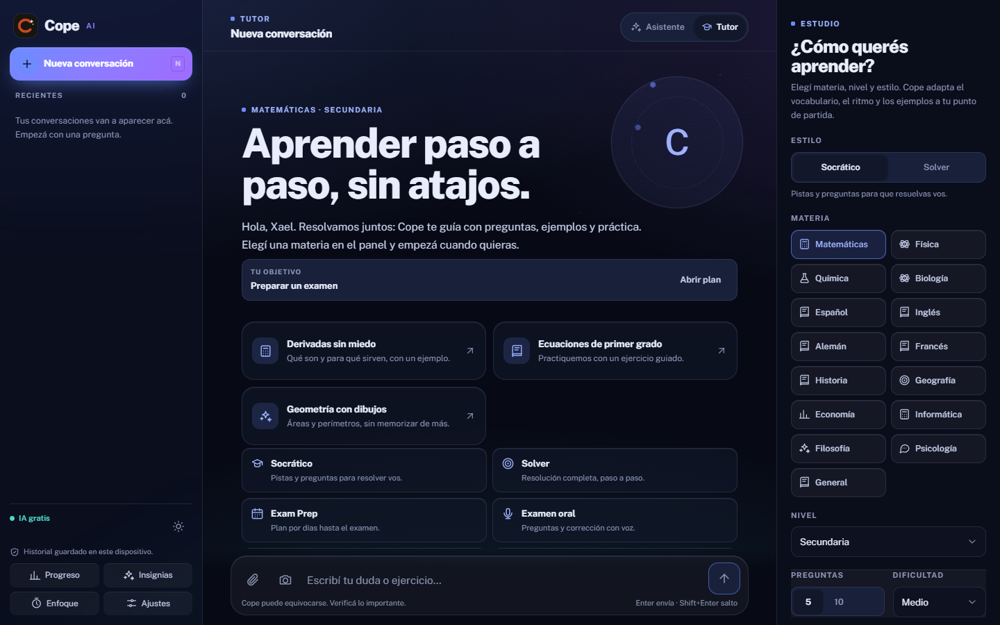 | 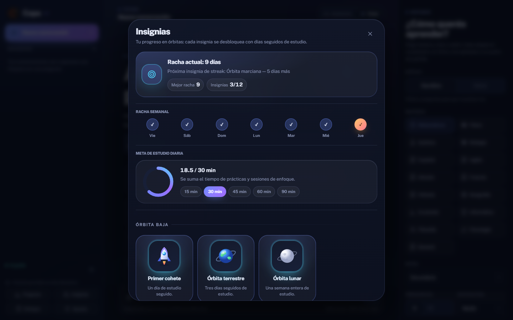 |

| Barra de progreso con tiempo estimado |
| --- |
| 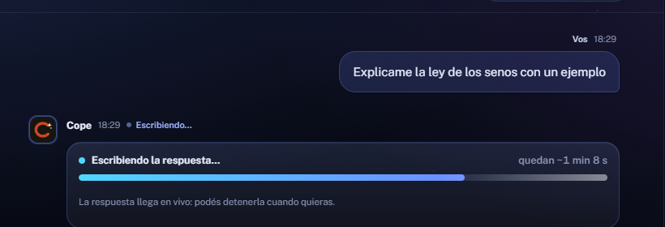 |

| Bienvenida | Escritorio |
| --- | --- |
| 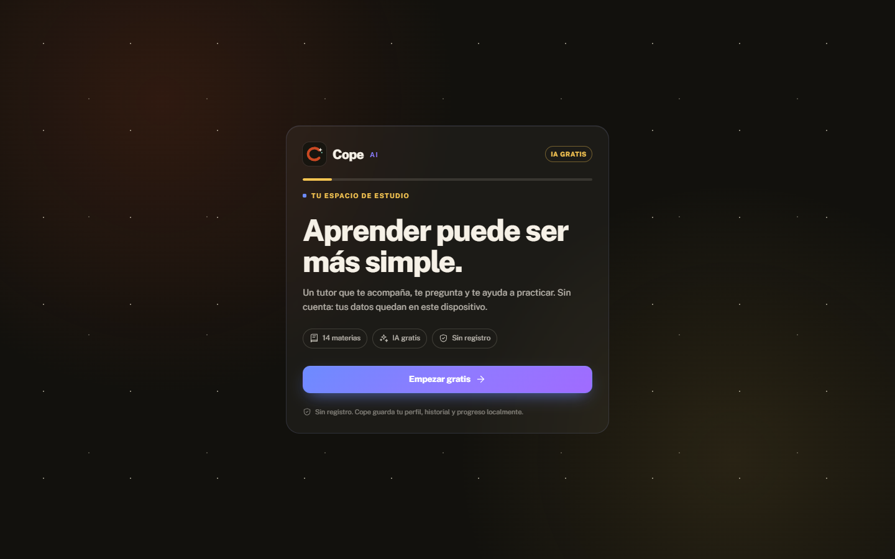 | 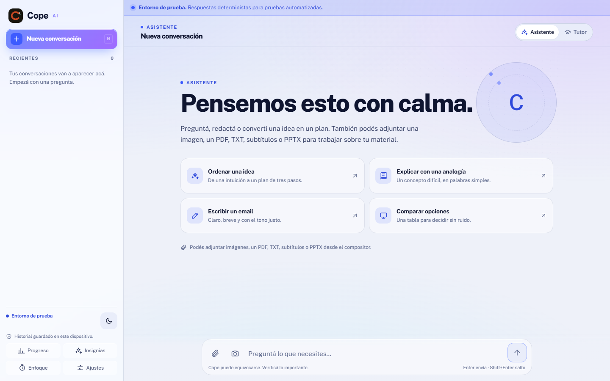 |

| Móvil |
| --- |
| 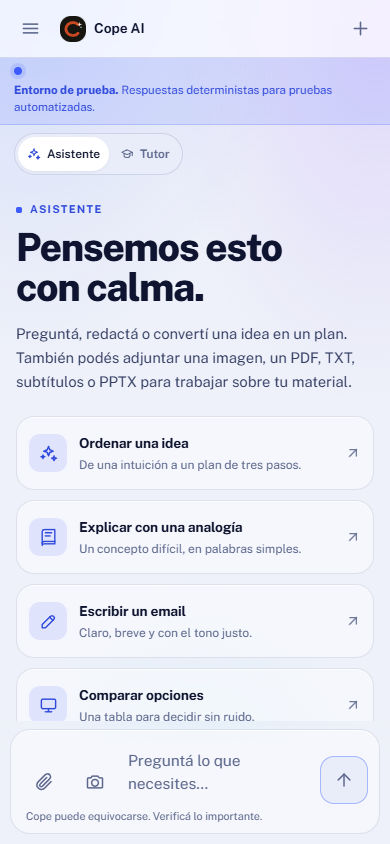 |

| Tutor y configuración | Plan de examen |
| --- | --- |
| 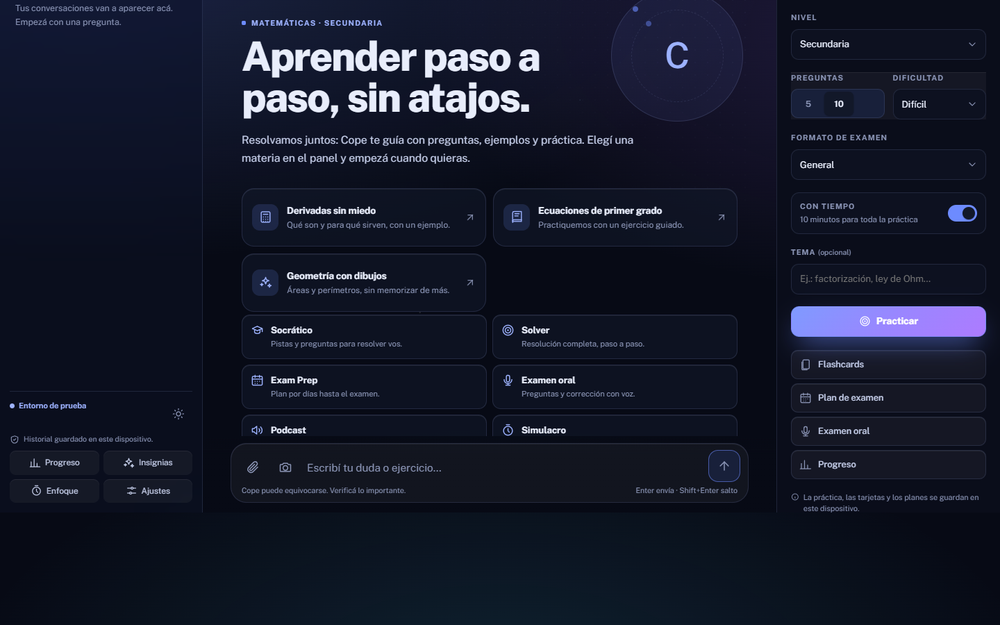 | 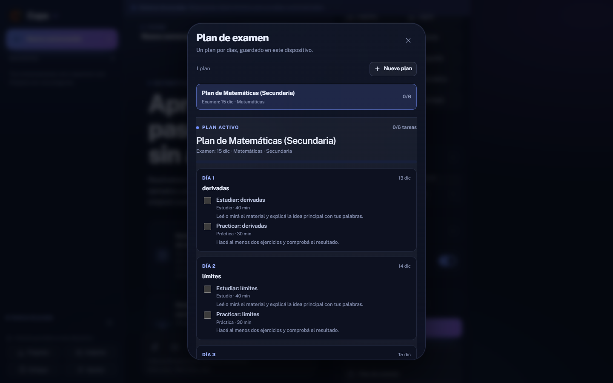 |

| Personalidad y voz | Examen oral |
| --- | --- |
| 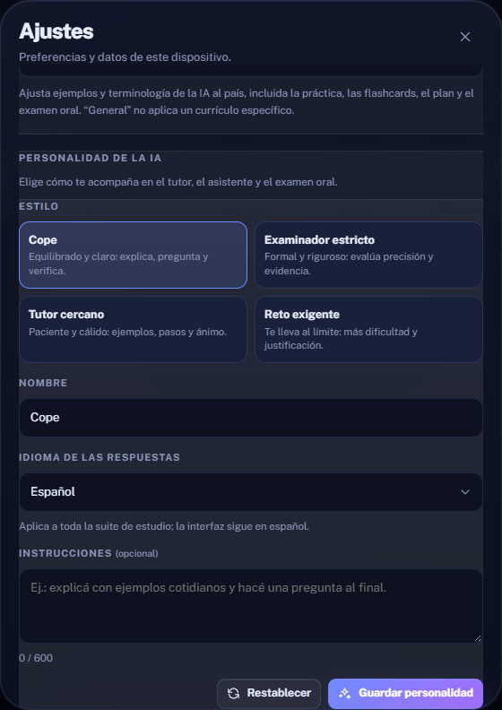 | 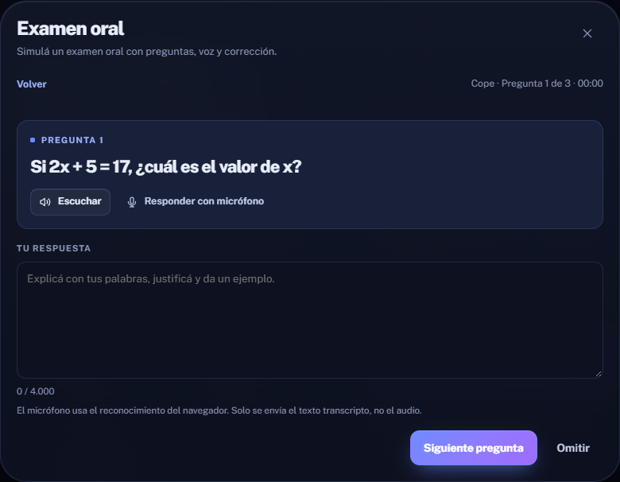 |

<p align="center">
  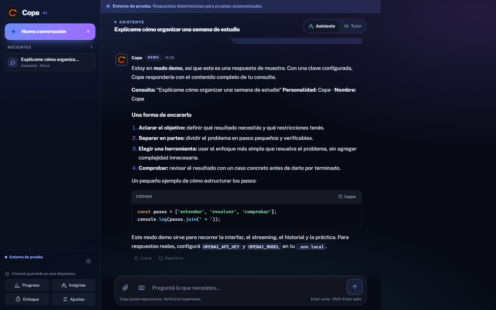
</p>

Capturas reales del build de producción con el motor gratuito.

## Empezar

Requisitos: Node.js 22.22+ y npm 11+.

```bash
npm install
npm run dev
```

Abrí `http://localhost:5173`. Sin variables de entorno, Cope AI arranca con
**IA gratuita de nube**: Pollinations no requiere clave, pero limita a
aproximadamente una respuesta cada 30 segundos por IP. Si preferís privacidad y
no te importa la velocidad, usá Ollama local. La app no muestra respuestas demo:
si el motor falla, informa el error y permite reintentar.

### Motores gratuitos

| Motor | Cómo activarlo | Ventajas | Límites |
| --- | --- | --- | --- |
| Nube gratuita (default) | nada | arranca al abrir y funciona en Vercel | tercera parte, ~1 respuesta/30 s, sin visión |
| Ollama local | `COPE_AI_PROVIDER=ollama` y Ollama abierto | privado y sin cuota | solo en tu equipo; CPU lenta |
| Clave gratuita propia | `OPENAI_API_KEY`, `OPENAI_MODEL` y `OPENAI_BASE_URL` | mejor calidad/cuota | requiere crear la clave en el proveedor |

La nube gratuita envía los mensajes a un servicio público de terceros. No la uses
con información sensible. El modo de fixtures (`COPE_DEMO=1`) queda reservado
para tests internos y no se muestra al usuario.

### Conectar un proveedor real

1. Copiá el ejemplo a tu entorno local:

   ```bash
   cp .env.example .env.local
   ```

2. Completá `.env.local` con tu proveedor. **El archivo está ignorado por git.**

   ```dotenv
   OPENAI_API_KEY=tu_clave
   OPENAI_BASE_URL=https://api.openai.com/v1
   OPENAI_MODEL=tu_modelo
   ```

3. Reiniciá `npm run dev`. Si no configurás nada, la app usa Pollinations
   gratuito; si configurás clave y modelo, usa tu proveedor.

La clave se lee **solo del lado servidor**. Nunca uses variables `VITE_*` para
secretos: todo lo que empieza con `VITE_` se incluye en el bundle público.

### Proveedores compatibles

Cualquier endpoint compatible con `POST {base}/chat/completions` y streaming SSE.
La base URL puede incluir o no `/chat/completions` al final.

- **OpenAI:** `OPENAI_BASE_URL=https://api.openai.com/v1`
- **OpenRouter:** `OPENAI_BASE_URL=https://openrouter.ai/api/v1`
- **Ollama local:** `OPENAI_BASE_URL=http://localhost:11434/v1`; usá cualquier
  valor no vacío como clave y el modelo instalado.

> En Ollama local Cope espera hasta 3 minutos por respuesta y 4 por JSON. El
> primer request puede tardar ~90 s mientras el modelo se carga en CPU; los
> siguientes suelen responder en segundos.

- **Otros:** revisá que soporten streaming y, si querés quiz/imágenes, JSON mode
  y visión.

Variables opcionales:

| Variable | Para qué |
| --- | --- |
| `OPENAI_TOKEN_PARAM` | `max_tokens` (default) o `max_completion_tokens` según el proveedor |
| `OPENAI_JSON_MODE=1` | Envía `response_format: json_object` al generar práctica |
| `OPENAI_VISION=0` | Rechaza imágenes en el servidor |
| `COPE_AI_PROVIDER` | `auto` (default), `openai`, `ollama` o `pollinations` |
| `COPE_LOCAL_AI=1` | Atajo para elegir Ollama local |
| `OLLAMA_BASE_URL` | URL local (default `http://127.0.0.1:11434/v1`) |
| `OLLAMA_MODEL` | Modelo local (default `qwen2.5:3b-cpu`) |
| `OLLAMA_VISION=1` | Permite imágenes si el modelo local tiene visión |
| `POLLINATIONS_MODEL` | Modelo de la nube gratuita (default `openai`) |
| `POLLINATIONS_API_KEY` | Clave opcional de Pollinations para más cuota |
| `COPE_DEMO=1` | Fixtures deterministas solo para tests internos |
| `COPE_DEMO_DELAY_MS` | Ritmo del streaming de fixtures (default 15) |
| `COPE_RATE_LIMIT_PER_MINUTE` | Límite por IP para chat (default 10) |
| `COPE_QUIZ_RATE_LIMIT_PER_MINUTE` | Límite por IP para práctica (default 5) |
| `COPE_STUDY_RATE_LIMIT_PER_MINUTE` | Límite por IP para flashcards y planes (default 5) |
| `COPE_ORAL_RATE_LIMIT_PER_MINUTE` | Límite por IP para exámenes orales (default 3) |
| `ELEVENLABS_API_KEY` | Clave server-side para voz externa y clonación |
| `ELEVENLABS_VOICE_ID` | Voz predefinida de ElevenLabs (necesaria para la voz externa) |
| `ELEVENLABS_MODEL_ID` | Modelo de voz (default `eleven_multilingual_v2`) |
| `COPE_VOICE_CLONE=1` | Habilita la clonación desde una muestra MP3 |
| `COPE_VOICE_CLONE_CODE` | Código de propietario para clonar y usar voz externa |
| `COPE_TTS_RATE_LIMIT_PER_MINUTE` | Límite por IP de reproducciones externas (default 10) |
| `COPE_VOICE_CLONE_RATE_LIMIT_PER_MINUTE` | Límite por IP de clonaciones (default 2) |

## Funciones

- **Bienvenida local:** onboarding join-ready con nombre, nivel, 14 materias,
  fecha de examen, país de referencia, objetivo y voz. No hay cuenta ni botones
  de OAuth falsos; el perfil se guarda en el dispositivo.
- **14 materias:** matemáticas, física, química, biología, español, inglés,
  alemán, francés, historia, geografía, economía, informática, filosofía y
  psicología, además de General.
- **Personalidad:** nombre, preset (Cope, examinador estricto, tutor cercano,
  reto exigente), idioma de respuesta (38 opciones), país de referencia del
  currículo e instrucciones libres. El idioma aplica al chat, tutor, práctica,
  tarjetas, plan, examen oral y podcast; el país, a toda la suite de estudio. Se
  guarda solo en este dispositivo.
- **Currículo por país:** 12 países + General con etapas, examen de referencia
  (PAES, EBAU, Saber 11, admisión, etc.) y marco curricular. La IA alinea temas
  y terminología; son referencias generales, no contenido oficial.
- **Tutor:** materia, nivel y dos estilos. **Socrático** da pistas y preguntas
  para que resuelvas vos; **Solver** muestra el procedimiento completo y la
  comprobación. El objetivo elegido en el onboarding se muestra como primer paso
  recomendado.
- **Práctica:** 5 o 10 preguntas, dificultad, tema opcional y modo con tiempo.
  Corrige al instante, explica cada respuesta y guarda el resultado. El formato
  de examen se sugiere según el país (PAES, Selectividad, ICFES o admisión).
- **Simulacro:** 10 preguntas con tiempo y formatos orientativos tipo PAES,
  Selectividad, ICFES o admisión. Son preguntas generadas, no oficiales.
- **Progreso:** nivel de preparación con objetivo 85%, precisión global y por
  materia, racha de días, actividad de la semana, logros por constancia, puntos
  a reforzar (materias practicadas bajo 70%) y últimas prácticas.
- **Flashcards:** generación por materia o tema (también desde el último PDF o
  TXT),
  repaso con repetición espaciada y decks persistentes. “Todo al día” no
  reprograma tarjetas sin vencer.
- **Plan de examen:** 3 a 14 días, fecha y temas; tareas de estudio, práctica,
  repaso y descanso con avance marcable.
- **Examen oral:** preguntas abiertas con rúbrica, respuesta por texto o
  micrófono, corrección con puntajes y zonas de desempeño, respuesta modelo e
  historial local. La voz del navegador está siempre disponible y sigue el
  idioma de respuesta elegido en Personalidad.
- **Podcast:** guion breve por materia o tema, con reproducción por la voz del
  navegador y texto para seguir la explicación.
- **Modo enfoque:** temporizador Pomodoro de 25 minutos de estudio y 5 de
  descanso, con pausa, reinicio, progreso, sesiones completadas y aviso al
  terminar cada fase; sigue corriendo aunque cierres el panel.
- **Velocidad y tono:** en Ajustes → Voz podés ajustar la velocidad (±50%) y el
  tono (±6 semitonos) de la voz del navegador.
- **Voz externa opcional:** ElevenLabs puede leer las preguntas como MP3. La
  clonación de una muestra MP3 es opcional, requiere consentimiento y código de
  propietario, y no guarda el audio en el servidor.
- **Asistente:** chat general con markdown, tablas, código y matemáticas KaTeX.
- **Adjuntos:** hasta 2 imágenes por conversación (redimensionadas a JPEG), foto
  de tarea con la cámara trasera y un PDF, TXT, subtítulos SRT/VTT o PPTX por
  mensaje (texto extraído localmente, sin OCR). Los subtítulos permiten estudiar
  una clase en video sin subir el video.
- **Historial local:** conversaciones, prácticas, decks, planes y exámenes orales
  en IndexedDB; el servidor no los guarda.
- **Streaming real:** SSE desde el proxy, con botón de detener, respuesta parcial
  conservada y reintento.
- **Barra de carga con tiempo estimado:** mientras la IA responde, una barra
  muestra la fase ("preparando" o "escribiendo") y cuánto falta aproximadamente
  ("quedan ~12 s"). La estimación se afina con las últimas respuestas reales
  del dispositivo y nunca marca 100 % antes de que la respuesta termine.
- **Insignias por órbita:** 12 insignias (Primer cohete, Órbita terrestre,
  Órbita lunar…) que se desbloquean con días seguidos de estudio, con la
  racha semanal, la próxima insignia a alcanzar y el anillo de la meta diaria
  (15 a 90 minutos, configurable).
- **PWA:** instalable, shell offline, fuentes empaquetadas y aviso de actualización.
- **Temas:** claro, oscuro y sistema. El **oscuro es el tema por defecto**.

### Datos de estudio

Los resultados de práctica, decks, planes y exámenes orales viven en IndexedDB
(versión 3) en este dispositivo. No hay cuentas ni sincronización. **Ajustes →
Borrar todo** elimina conversaciones, prácticas, flashcards, planes y exámenes;
también podés borrar un deck, un plan o un examen desde su panel. La personalidad
y la preferencia de voz se guardan aparte para poder restablecerlas sin perder el
historial.

## Arquitectura

```text
┌──────────────────────────┐
│  PWA React + TypeScript  │
│  IndexedDB local         │
└────────────┬─────────────┘
             │ /api/chat (SSE) · /api/quiz · /api/flashcards ·
             │ /api/study-plan · /api/oral-exam · /api/podcast (JSON) ·
             │ /api/tts · /api/voice-clone
             ▼
┌──────────────────────────┐
│  Handlers compartidos    │  dev/preview: middleware Vite
│  validación + límites    │  producción: funciones Vercel
│  prompts + seguridad     │
└────────────┬─────────────┘
             │ Authorization: Bearer (solo servidor)
             ▼
┌──────────────────────────┐       ┌──────────────────────┐
│  Proveedor OpenAI-       │       │  ElevenLabs (opcional)│
│  compatible              │       │  TTS MP3 / clonación  │
└──────────────────────────┘       └──────────────────────┘
```

- `shared/`: contratos zod (chat, quiz, estudio, personalidad, oral y voz),
  parser SSE, extracción/reparación de JSON y cálculo de zonas.
- `server/`: selección de motor (Pollinations/Ollama/OpenAI-compatible),
  configuración, prompts, proveedores, rutas y seguridad. Las rutas JSON
  reintentan una vez dentro de un presupuesto de tiempo acotado.
- `api/`: adaptadores finos para Vercel, incluido TTS/clonación opcional.
- `src/`: interfaz, almacenamiento local, SRS, progreso, voz del navegador,
  adjuntos y cliente SSE.

### Estructura

```text
api/                    funciones Vercel
server/                 lógica del proxy y del proveedor
shared/                 esquemas y utilidades compartidas
src/                    PWA React
e2e/                    pruebas Playwright
twa/                    configuración y pasos para Android
scripts/                generación de iconos y captura visual de control
```

La identidad visual vive en `src/styles/tokens.css` (paleta y tema por
defecto) más la capa `src/styles/astra.css`, que se importa después de
`app.css`. Los módulos de la barra de progreso y la gamificación son
`src/lib/generationProgress.ts`, `src/lib/studyLog.ts`,
`src/lib/achievements.ts` y `src/features/achievements/`.

El detalle de la última tanda de cambios, con lo que quedó pendiente, está en
[`docs/HANDOFF-ASTRA.md`](docs/HANDOFF-ASTRA.md).

## Comandos

| Comando | Qué hace |
| --- | --- |
| `npm run dev` | Servidor de desarrollo con API local |
| `npm run build` | Typecheck + build de producción |
| `npm run preview` | Sirve el build con el mismo proxy API |
| `npm run typecheck` | TypeScript de cliente y servidor |
| `npm run lint` | ESLint |
| `npm run test` | Vitest (unidad, integración y componentes) |
| `npm run test:e2e` | Build + Playwright con fixtures de prueba (timeout 90 s) |
| `npm run verify` | Typecheck + lint + tests + build |
| `npm run icons` | Regenera los iconos PWA desde `public/logo.svg` |

## Seguridad y límites

- Secretos únicamente en `.env.local` o variables de Vercel. `.env.example` no
  contiene valores.
- Validación zod antes de llamar al proveedor; se descartan roles `system`
  enviados por el cliente.
- Topes: 3 MB por body, 24 mensajes, 24.000 caracteres por mensaje, 32.000 en
  total, 2 imágenes de hasta 1,2 MB como data URL, 1 PDF (20 páginas y 20.000
  caracteres extraídos), TXT o subtítulos SRT/VTT (2 MB y 8.000 caracteres) o
  PPTX (15 MB y 40 diapositivas) por mensaje, 1.200 tokens de salida por
  respuesta de chat.
  Práctica: 5 o 10 preguntas y 5.000 tokens. Flashcards: 6 a 10 tarjetas,
  8.000 caracteres de material y 2.500 tokens. Plan: 3 a 14 días, 8 temas y
  3.000 tokens. Oral: 3, 5 u 8 preguntas, 4.000 caracteres por respuesta.
  TTS: 600 caracteres por reproducción y muestra de voz de hasta 5 MB.
- Rate limit en memoria por IP: 10 chat/min, 5 práctica/min, 5 generaciones de
  estudio/min, 3 exámenes orales/min, 10 reproducciones externas/min y
  2 clonaciones/min. **No es un límite distribuido**: en serverless cada
  instancia tiene su propia memoria.
- La voz externa y la clonación requieren `COPE_VOICE_CLONE_CODE`; el código se
  compara en tiempo constante y se guarda solo en `sessionStorage`. La muestra
  MP3 no se guarda en Cope AI. La clonación es un dato biométrico: exige
  consentimiento explícito, permiso del hablante y posibilidad de borrado.
- Errores sanitizados: nunca se devuelven claves, headers ni cuerpos crudos del
  proveedor.
- Markdown sin HTML crudo, protocolos permitidos y KaTeX sin `trust`.
- CSP y cabeceras de seguridad en `vercel.json`; el service worker nunca cachea
  `/api`.

### Antes de exponer una clave en producción

Cope AI **no tiene autenticación**. Si desplegás una URL pública con tu clave,
cualquiera puede consumir tu cuota. Antes de hacerlo:

1. Configurá un **tope de gasto** en el proveedor.
2. Usá rate limiting/WAF de Vercel (el límite en memoria es solo una primera
   barrera).
3. Considerá agregar autenticación o un access gate en una versión futura.

## Despliegue en Vercel

1. Importá el repo en Vercel. El framework se detecta como Vite; el build es
   `npm run build` y la salida `dist`. Sin variables usa Pollinations gratuito.
2. Opcional: cargá `OPENAI_API_KEY`, `OPENAI_BASE_URL` y `OPENAI_MODEL` para un
   proveedor gratuito propio (Gemini/Groq/OpenRouter compatibles) o
   `COPE_AI_PROVIDER=ollama` para desarrollo local. No pongas claves en el repo.
3. Desplegá. Se incluyen `api/chat.ts`, `api/quiz.ts`,
   `api/flashcards.ts`, `api/study-plan.ts`, `api/oral-exam.ts`, `api/tts.ts`
   y `api/voice-clone.ts`; `vercel.json` fija `maxDuration` y las cabeceras/CSP.
4. Verificá `/api/health` y una conversación real. El streaming en producción
   requiere el runtime Node de Vercel.
5. Para voz externa, cargá las variables de ElevenLabs y el código de propietario
   solo en Vercel. Sin ellas, el examen oral sigue usando la voz del navegador.
6. Instalá la PWA desde Chrome en Android o escritorio.

## PWA y Android (TWA)

La app ya incluye manifest, iconos, service worker, shell offline y aviso de
actualización. Para publicarla en Play Store hace falta empaquetarla como TWA;
los pasos, el manifest de ejemplo y los placeholders de firma están en
[`twa/README.md`](twa/README.md).

El APK/AAB **no se compila en este repo** ni en la máquina de desarrollo
original: requiere Android SDK, Gradle, un keystore propio y Play Console.

## Pruebas

- **Unitarias/integración:** parser SSE, selección de motor gratuito/local,
  esquemas de chat/quiz/estudio, personalidad, oral, voz, prompts, rate limit,
  proveedor con upstream falso, reparación de JSON con presupuesto, SRS,
  progreso, IndexedDB con migración v1→v3, perfil/onboarding, payload y adjuntos.
- **Componentes:** onboarding, tutor, personalidad, voz, cámara, markdown
  seguro, quiz, composer y lista de mensajes.
- **E2E:** Chrome/Chromium real contra el build con fixtures de prueba:
  onboarding, asistente, respuesta parcial tras corte, personalidad del tutor,
  práctica de 10 con tiempo y progreso, flashcards con repaso, plan de examen,
  examen oral completo con historial, cámara, PDF, borrado durante streaming,
  PWA/offline, accesibilidad de los diálogos y capturas.

```bash
npm run verify
npm run test:e2e
```

Las llamadas a un proveedor real y el despliegue en Vercel no se ejecutan en la
suite automática porque dependen de tu clave y tu cuenta.

## Privacidad

- Las conversaciones, imágenes procesadas, texto extraído de PDF/TXT/subtítulos/PPTX,
  resultados de práctica, decks, planes y exámenes orales se guardan en
  IndexedDB en tu navegador.
- La personalidad y la preferencia de voz se guardan en almacenamiento local; el
  código de propietario vive solo en `sessionStorage`.
- El PDF original no se sube desde el dispositivo: solo viaja el texto extraído.
  El TXT, los subtítulos SRT/VTT y el texto de las diapositivas PPTX se leen
  localmente y también viajan solo como texto.
- Las imágenes (incluidas las fotos de tarea) y los mensajes sí se envían al
  proveedor configurado cuando usás IA real.
- La nube gratuita (Pollinations) es un servicio de terceros; envía los mensajes
  fuera del dispositivo. Ollama local mantiene la inferencia en tu equipo.
- En el examen oral, el micrófono usa el reconocimiento del navegador: el audio
  no se envía a Cope AI, solo el texto transcripto.
- Si habilitás voz externa, el texto de la pregunta se envía a ElevenLabs para
  generar MP3. Si clonás una voz, la muestra MP3 se envía a ElevenLabs y no se
  conserva en Cope AI.
- Cope AI no incluye analítica, cuentas ni sincronización en la nube.

## Licencia

MIT. Ver [LICENSE](LICENSE). Las fuentes y dependencias de terceros se detallan
en [THIRD_PARTY_NOTICES.md](THIRD_PARTY_NOTICES.md).
